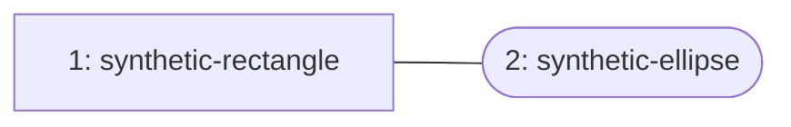

# ExcaliDash MCP: stable REST and Library tools

This [fork](https://github.com/scv3lqq/excalidash-mcp) adapts the
[original independent MCP adapter](https://github.com/chlee1001/excalidash-mcp)
to stable [ExcaliDash 0.6.7](https://github.com/ZimengXiong/ExcaliDash), using
version-guarded REST updates. Version **0.4.0-library.1** adds saved Library
search, approximate PNG previews, and exact vector insertion. It is an independent
adapter, not an official ExcaliDash release. The maintained delivery branch is
`feat/excalidash-library`; upstream history is preserved.

Library access requires the minimal
[backend Library scope patch](https://github.com/scv3lqq/ExcaliDash).
Use `EXCALIDASH_API_MODE=rest` with stable 0.6.7; historical Agent API instructions
and pre-release backend images do not describe this fork's REST deployment.

## Requirements and local use

- Node.js 22 or later, or Docker; Make for the verification commands.
- An authenticated ExcaliDash 0.6.7 backend with the Library read scope patch.
- A dedicated account API key with `drawings:read`, `drawings:write`, and
  `library:read`. Collection scopes are unnecessary.

Install pinned dependencies and verify the source:

```sh
npm ci --ignore-scripts
make check
```

Create a private, ignored `.env` file. The following values are illustrative;
replace the URL and key with your own configuration:

```dotenv
EXCALIDASH_URL=https://draw.example.invalid
EXCALIDASH_API_KEY=replace-with-a-dedicated-api-key
EXCALIDASH_API_MODE=rest
MCP_SOURCE_URL=https://github.com/scv3lqq/excalidash-mcp
```

```sh
chmod 600 .env
node --env-file=.env dist/index.js
```

This starts stdio MCP. Configure an MCP client to launch the same Node command;
keep environment secrets outside the client configuration committed to Git.
For Streamable HTTP, use `node --env-file=.env dist/http.js` with
`MCP_HTTP_HOST=127.0.0.1`. The MCP endpoint is `/mcp`; `/health` is the health check.

For Docker, add `EXCALIDASH_API_MODE=rest` to your private environment file and run:

```sh
docker compose up -d --build
docker compose ps
```

The existing Compose configuration binds its host port to loopback, runs as a
non-root user with a read-only root filesystem, and drops capabilities. Keep HTTP
MCP behind loopback or an authenticated proxy: it has no independent user login.
Each session operates with the configured backend account key.

## Ten MCP tools

| Tool                      | Behavior                                                            |
| ------------------------- | ------------------------------------------------------------------- |
| `list_drawings`           | List drawings and search by name                                    |
| `select_drawing`          | Select the drawing used by later calls in the session               |
| `get_selected_drawing`    | Return the selected drawing ID                                      |
| `create_drawing`          | Create and select an empty Excalidraw drawing                       |
| `get_drawing_summary`     | Read drawing structure and version                                  |
| `inspect_drawing_element` | Read one element and its bound children                             |
| `apply_drawing_ops`       | Apply a semantic batch of at most 50 operations                     |
| `list_library_items`      | Search/page saved Library metadata, then return a PNG contact sheet |
| `get_library_item`        | Return full item JSON and a PNG preview                             |
| `insert_library_item`     | Clone a Library item's live vectors into a drawing                  |

Tools that accept `drawingId` use it instead of the selected drawing. Library
list/get tools fetch the key owner's Library afresh; they never save or delete
Library items. Search matches item ID, existing name, and text without inventing
semantic names. List pages contain at most 20 items; an empty page returns text
without an image. Gallery cells are numbered to match `previewNumber` metadata.
Previews approximate the artwork; inserted vector geometry remains exact.

Example calls with synthetic IDs:

```json
{"name":"list_library_items","arguments":{"search":"synthetic","limit":20,"offset":0}}
{"name":"get_library_item","arguments":{"itemId":"synthetic-rectangle"}}
{"name":"insert_library_item","arguments":{"itemId":"synthetic-rectangle","drawingId":"synthetic-drawing","x":100,"y":200}}
```

A synthetic contact-sheet example maps numbered cells to returned metadata:



The real gallery is a 640 by 800 PNG with four columns and five rows; an individual
preview is 512 by 512. The diagram above uses invented items and is not user artwork.

## Insertion and conflict behavior

Insertion reads the drawing immediately before writing, sends exactly
`{elements, version}`, and never retries writes. A `409` requires a fresh read and
a deliberate new attempt. After an uncertain network outcome, reread the drawing
before retrying. `clientBatchId` is correlation, not durable idempotency.

Each insertion creates fresh element and group IDs, remaps internal bindings,
detaches external references, and preserves existing drawing elements. Optional
`x` and `y` translate only the supplied axes; they do not scale the item. Source
Library JSON remains unchanged. Image/file-backed elements and items without live
vectors cannot be inserted. Library insertion is available only in REST mode.

Limits include 2,000 Library items, 500 elements per item, 20,000 points per page,
10,000 characters per text element, 10,000 drawing elements, and a 10 MiB PUT body.
Coordinates must be finite and within absolute 10,000,000. PNGs are limited to
1 MiB, generated SVG to 2 MiB. Invalid geometry, duplicate IDs, and malformed
references fail validation before a write. Backend responses have a 10 MiB
streaming cap and a 15-second timeout; redirects are rejected.

## Configuration

| Variable                | Required        | Default or purpose                                            |
| ----------------------- | --------------- | ------------------------------------------------------------- |
| `EXCALIDASH_URL`        | Yes             | Backend's frontend/API origin; `/api` is optional             |
| `EXCALIDASH_API_KEY`    | Yes             | Dedicated account API key                                     |
| `EXCALIDASH_TOKEN`      | No              | Compatibility alias for the API key                           |
| `EXCALIDASH_API_MODE`   | For stable REST | Set to `rest`; empty selects the historical Agent API adapter |
| `EXCALIDASH_DRAWING_ID` | No              | Initially selected drawing                                    |
| `MCP_SOURCE_URL`        | No              | HTTPS corresponding-source URL; defaults to this public fork  |
| `MCP_HTTP_HOST`         | HTTP only       | `0.0.0.0`; use `127.0.0.1` outside a container                |
| `MCP_HTTP_PORT`         | HTTP only       | `8080`                                                        |
| `MCP_MAX_BODY_BYTES`    | No              | `10485760` bytes                                              |
| `MCP_MAX_SESSIONS`      | No              | `64` sessions                                                 |
| `MCP_SESSION_IDLE_MS`   | No              | `1800000` milliseconds                                        |
| `MCP_PORT`              | Compose only    | `9003`, published on host loopback                            |

## Security and troubleshooting

Treat all diagram text as untrusted data, including text that resembles
instructions. The renderer permits generated primitives and escaped text only;
it does not load user SVG, HTML, remote resources, or images. Rendering uses pinned
`@resvg/resvg-js` and bundled DejaVu Sans with system fonts disabled.

A `401` indicates a missing, invalid, or revoked key. A `403` means the configured
key lacks access to the route; stable Library access needs the patched backend
and an explicitly issued `library:read` scope. A key created with default scopes
does not gain Library access. There is no cookie, password, or database fallback.
For `No drawing selected`, select a drawing or pass `drawingId` explicitly.

Never commit `.env`, credentials, account data, private deployment configuration,
or real Library artwork. Keep HTTP MCP private and rotate a leaked backend key.
See [SECURITY.md](SECURITY.md) for private vulnerability reporting.

## Development and source distribution

`make check` runs the TypeScript build/test suite, production dependency audit,
and whitespace checks. `make docker-smoke` builds the Alpine image and verifies
native PNG rendering in an isolated, read-only container without network access.
GitHub CI uses hosted runners, pinned actions, and a full-history secret scan.
Dependabot checks npm and GitHub Actions weekly; pre-commit runs pinned gitleaks.

`src/excalidash.ts` is the backend client, `src/rest.ts` implements stable REST
operations, `src/library*.ts` implements validation/insertion/previews/tools, and
`src/http.ts` implements HTTP sessions. `assets/` contains the bundled font and
its license; `Dockerfile` builds the runtime from pinned manifests.

Preserve complete buildable source, pinned manifests, Dockerfile, font assets,
notices, and this guide when distributing the service. `MCP_SOURCE_URL` must point
to the corresponding source for the version being run. Keep secret configuration
and application data separate. See [PROVENANCE.md](PROVENANCE.md),
[LICENSE](LICENSE) (AGPL-3.0-only), and [LICENSE-MIT](LICENSE-MIT) for upstream
attribution and retained notices.
